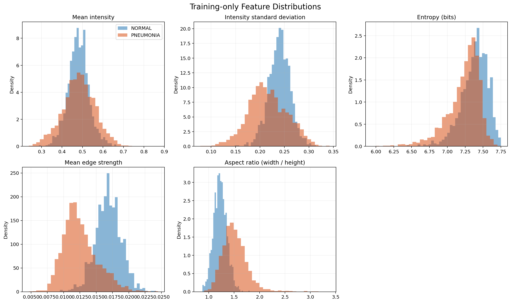
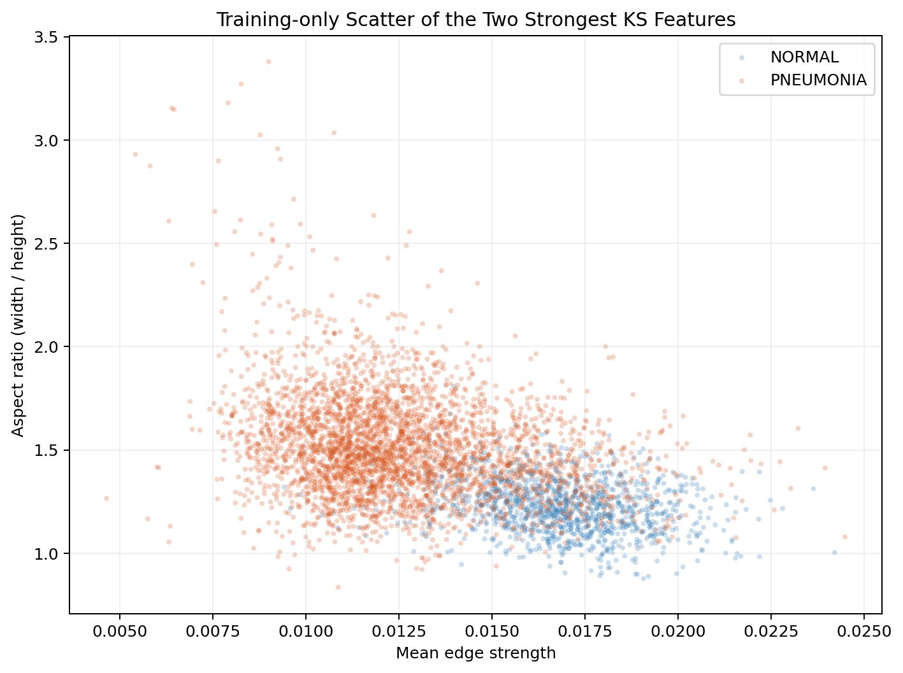
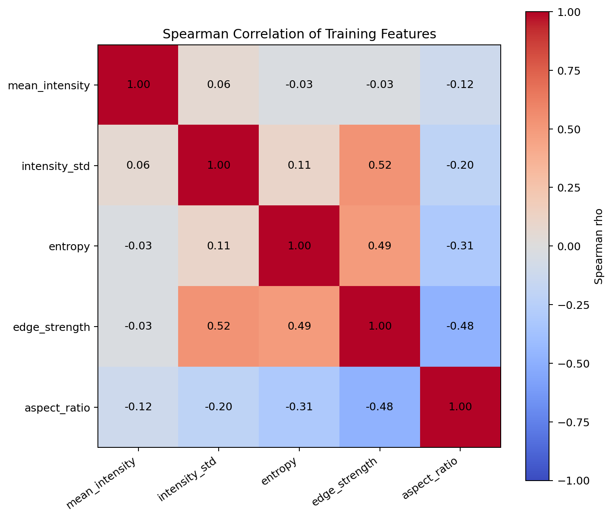

# Exploratory Feature Analysis

## 1. Distribution Contrast

本分析嚴格只使用 `re_split/train` 的 4,708 張影像，包括 1,214 張 `NORMAL` 與 3,494 張 `PNEUMONIA`；validation 與 test 完全未讀取。影像轉為灰階並縮放至 256×256 後，提取平均亮度、亮度標準差、entropy 與相鄰像素的平均 edge strength；aspect ratio 則使用原始寬高計算。下圖使用 density-normalized histograms，避免兩類樣本數不同直接影響柱高。

兩類的平均亮度中位數接近（NORMAL 0.480、PNEUMONIA 0.482），顯示整體亮度本身的辨識力有限。相較之下，PNEUMONIA 的亮度標準差、entropy 與 edge strength 中位數較低，分別為 0.213、7.284、0.0121；NORMAL 則為 0.240、7.404、0.0169。PNEUMONIA 的 aspect ratio 中位數較高（1.488 vs. 1.222）。

Edge strength 與 aspect ratio 的散點圖呈現明顯但不完全的群聚差異，兩類仍有大量重疊。因此這些簡單特徵可提供方向，但不足以單獨作為可靠的肺炎判定規則。

## 2. Feature Separability & Association

使用 two-sample KS statistic 與 Wasserstein distance 衡量兩類分布差異，並以 mutual information（MI）及 point-biserial correlation 衡量特徵與標籤的關聯。Standardized Wasserstein 以兩類 pooled standard deviation 標準化，便於跨特徵比較。

| Feature | NORMAL median | PNEUMONIA median | KS | Std. Wasserstein | MI (nats) | Point-biserial $r$ |
|---|---:|---:|---:|---:|---:|---:|
| Mean intensity | 0.480 | 0.482 | 0.129 | 0.341 | 0.028 | 0.011 |
| Intensity std | 0.240 | 0.213 | 0.399 | 0.803 | 0.098 | -0.279 |
| Entropy | 7.404 | 7.284 | 0.296 | 0.731 | 0.065 | -0.290 |
| Edge strength | 0.0169 | 0.0121 | **0.687** | **1.852** | **0.234** | **-0.606** |
| Aspect ratio | 1.222 | 1.488 | **0.594** | **1.436** | **0.186** | **0.485** |

Edge strength 的分離度最高，其次為 aspect ratio；intensity std 與 entropy 提供中等分離，mean intensity 最弱。各特徵的 KS test 均達統計顯著，但樣本數很大，因此應以 KS、standardized Wasserstein 與 MI 的效果量為主要依據，而不是只看 p-value。Mean intensity 的 point-biserial correlation 不顯著（$p=0.437$），也支持它不適合作為主要特徵。

合併兩類計算的 pooled Spearman correlation 顯示沒有 $|\rho|\geq0.8$ 的高度冗餘。較明顯的關聯是 intensity std 與 edge strength（$\rho=0.52$）、entropy 與 edge strength（$\rho=0.49$），以及 aspect ratio 與 edge strength（$\rho=-0.48$）。為避免 pooled correlation 只是由類別差異造成，我們也分別檢查兩類內部的相關性：NORMAL 的最大絕對相關約為 0.52，PNEUMONIA 約為 0.53，兩者同樣未達高度冗餘門檻。因此 contrast、entropy 與 edge strength 並非完全重複，但同時使用時仍應透過 ablation 確認各自的增益。Aspect ratio 的高分離度與它和 edge strength 的關聯也顯示資料可能存在拍攝尺寸、裁切或來源差異；它不應直接被解釋成肺炎病理特徵。

註：

- **Two-sample KS statistic：** 比較 NORMAL 與 PNEUMONIA 兩組特徵的累積分布，取兩條累積分布曲線的最大距離。數值介於 0 與 1；越接近 1，代表兩類分布越不同。它不只比較平均值，也能偵測分布形狀、位置或離散程度的差異。
- **Wasserstein distance：** 衡量把一類的特徵分布移動成另一類分布所需的距離；越大代表兩類相隔越遠。因不同特徵的尺度不同，本研究再除以兩類的 pooled standard deviation，得到 standardized Wasserstein，以便跨特徵比較。
- **Mutual information（MI）：** 衡量知道某個特徵後，能減少多少對類別標籤的不確定性。MI 為 0 表示特徵與標籤近似獨立；數值越大，表示關聯越強。MI 能捕捉非線性關係，但不表示因果關係。
- **Point-biserial correlation：** 衡量連續特徵與二元標籤之間的線性關聯，數值介於 -1 與 1。絕對值越大代表關聯越強；正負號表示 PNEUMONIA 相對於 NORMAL 的特徵值傾向較高或較低。

## 3. Exploratory Hypotheses

- **H1 — Texture hypothesis：** PNEUMONIA 的 edge strength、intensity std 與 entropy 較低，因此包含局部紋理或多尺度邊緣資訊的表示，應比只使用平均亮度更能分離異常。
- **H2 — Contrast-normalization hypothesis：** 兩類的 intensity std 與 entropy 有中等差異。將比較原始灰階 normalization 與 contrast normalization；若 normalization 後仍能維持或提升 test 表現，表示模型學到的訊號不只是曝光或對比差異。

以上假設都由 training-only 結果提出；validation 只用於選擇 hyperparameters 與 threshold $\tau$，test 保持 unseen，直到最終評估。
