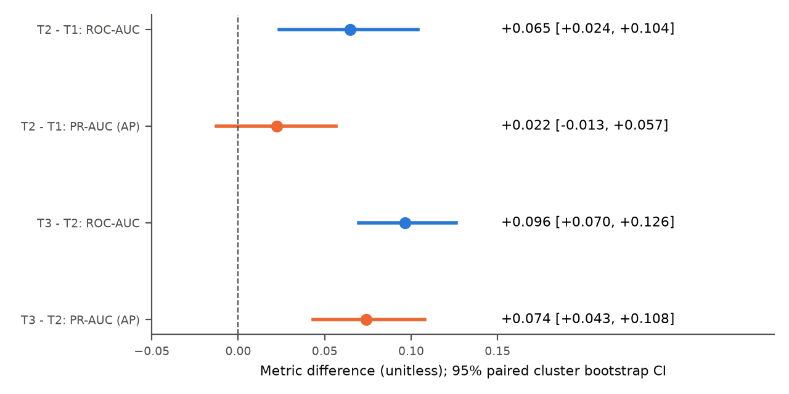
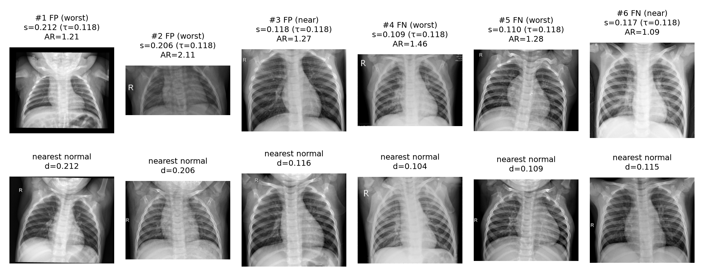

# 統計顯著性與錯誤案例分析

Chao Hsiao；2026-11-11。依 `79861e5` 的組員程式與固定 scores 分析。主方法、模型、τ 和 test 標籤均未更換；本次沒有重訓模型。

## 1. 範圍、輸入與分工

依本機 `../DM-HW2.pdf`（24 頁）及 2026-11-04 E3 補充公告：三個 tiers 共用 raw split 和 val/test；one-class 方法有 normal-only baseline；§6 列出各方法 NORMAL/異常訓練數。統計對應 spec p14，錯誤案例及解釋對應 p16–17。E3 網頁的新版本／額外附件尚未核對，這是本次規格核對的邊界。

| 工作 | 目前證據及責任 |
|---|---|
| Ding-Xiang Lin | 依使用者確認，負責資料統計、切分、前處理、feature analysis；`src/data_split.py`、`src/eda.py` 與原有 `doc/` 可查。 |
| Tien-Chia Chang | 依使用者確認，負責主實驗與 ablation；`charlie-ww` commits 已包含三個 tiers、共用評估、初版 bootstrap、錯誤案例、heatmap 與論文素材。不能把這些既有成果全歸給 Chao。 |
| Chao Hsiao（本次） | 核對原始資料、切分、逐筆 scores 與指標；補充 paired cluster bootstrap／Holm；重現及查證既有選例；修正統計、因果與解釋限制；更新交付文件與 LaTeX 匯出。 |

必要輸入都已取得：Kaggle v2 影像、組員 splitter、5,856 筆 feature 表、15 個方法的 val/test scores、各方法設定、既有 error/heatmap 輸出。保留 `path` 作識別碼，以 manifest 對齊，不依 CSV 列順序配對。原始標籤為 `NORMAL=0`、`PNEUMONIA=1`；一筆是一張影像，不是一位病人。

仍缺：正式整合的 ACL paper／簡報、HW2 TeamID／其他成員學號、Tier 3 原 recipe 是否曾用相同官方 test 做設計、真實 patient ID，以及 deterministic Tier 2 如何符合至少 3 seeds 的助教確認。Google Drive 以 `HW2`、`Data Mining` 各搜尋一次也未找到可存取檔案；這不表示其他組員沒有私人檔案。這些不阻止目前的 scores 分析，但影響最終交件與外推說法。

## 2. 資料與結果核對

- 固定來源為 [Chest X-Ray Images (Pneumonia), version 2](https://www.kaggle.com/datasets/paultimothymooney/chest-xray-pneumonia/versions/2)。下載 archive SHA-256、manifest、scores／設定的 SHA-256 和執行套件版本均記於 [`verification.json`](../results/statistics/verification.json)。未把下載來源的版本直接當作組員訓練版本已獨立證實；是以影像、split IDs、features、scores 的一致性核對。
- 沿用 `data_split.py` 的 seed 42 與 group-aware 90/10 development split，重建後與所有 scored IDs／標籤、feature IDs／split 完全一致。train 為 4,708（1,214 NORMAL／3,494 PNEUMONIA），val 為 524（135／389），test 為 624（234／390）。
- 逐張核對 5,856 張原始寬高，並重算所有影像 SHA-256：30 組完全重複影像，跨 split 為 0，與組員 leakage CSV 完全相同。沒有移除任何影像，分母仍為 624；test 內 6 組重複影像透過 cluster 處理相依性。
- 原有 1,234 個有限 per-seed 指標值全部重算一致，最大絕對差為 0；其餘 5 個 `tau=-inf` 也核對一致。既有 624 筆 `test_predictions.csv` 的 IDs、outcome 與 margin 核對通過。六個案例另由原始影像重算特徵，最大差異小於 1e-6。
- 「檔名＋bacteria/virus」group key 無跨 split 重疊；但只用 `personN` 時 train/test 有 150、val/test 有 20 個共用編號。不同類型可能各自編號，不能據此宣稱已取得真實 patient ID 或完全排除 patient leakage。檢查也不涵蓋重新壓縮／裁切的近似重複影像。

**模型來源區分**：Tier 1–3 和 ablation 的 scores 均為組員既有輸出；本次只重建 raw split、重算指標及 image features 作核對。未重建 DenseNet 權重、未重算神經網路 embeddings／最近鄰距離／heatmap、未新增模型或 ensemble。Tier 3 是三個已訓練 seeds 的指標平均，不是把三個 score 平均後形成的新模型。

## 3. 統計設計與結果（§7）

先理解比較單位：同一張 test 影像同時有兩個方法的 score，因此應配對比較。若同一檔名群組有多張影像，或檔案完全相同，逐張獨立重抽會忽略相依性。這次把同一檔名推定群組（PNEUMONIA 加 bacteria/virus）和 SHA-256 重複檔合併，得到 427 個 proxy clusters：224 NORMAL、203 PNEUMONIA。

採 **label-stratified paired cluster bootstrap**：每個 label 分別有放回抽完整群組，所有方法共用同一組重抽權重；保留群組內所有影像，計算 image-weighted 指標。重抽 5,000 次，seed 42。群組大小不等，因此各次影像數與陽性比例可能略變；沒有把 group 平均的指標誤寫成 image 指標。方法背景可參考 [Field & Welsh (2007)](https://doi.org/10.1111/j.1467-9868.2007.00593.x)；配對重抽的概念見 [SciPy bootstrap 文件](https://docs.scipy.org/doc/scipy/reference/generated/scipy.stats.bootstrap.html)。本程式用 multiplicity weights 計算，已與明確展開重抽樣本後的 sklearn AUC/AP 核對。

效果量為 `metric(method) - metric(reference)`，ROC-AUC 和 PR-AUC 均無單位；PR-AUC 沿用組員的 **average precision** 定義。差距的 95% CI 用 percentile bootstrap。虛無假設為指標差距 0；沿用組員的雙尾 bootstrap tail approximation：`min(1, 2*(min(nΔ≤0,nΔ≥0)+1)/(B+1))`，它不是 exact permutation p，也不是獨立 seed t-test。最小可報 raw p 為 2/5001，不能報 p=0。

主要報告兩個 ROC-AUC 比較，Holm family 大小 2；兩個 secondary AP 比較另成一個 family；九個 ablations × ROC-AUC/AP 共 18 個探索性比較另作 Holm。CI 是各比較的 marginal 95% CI，沒有作 simultaneous coverage 校正。所有比較分類都是看到組員現有結果後整理，**不是預先登錄的 confirmatory analysis**；Holm 也不能消除事後選擇偏差。

| 比較 | 指標 | Δ | cluster 95% CI | Holm p |
|---|---|---:|---|---:|
| Tier 2 − Tier 1 edge 3σ | ROC-AUC | +0.065 | [0.024, 0.104] | .004 |
| Tier 2 − Tier 1 edge 3σ | PR-AUC | +0.022 | [−0.013, 0.057] | .200 |
| Tier 3 − Tier 2 | ROC-AUC | +0.096 | [0.070, 0.126] | <.001 |
| Tier 3 − Tier 2 | PR-AUC | +0.074 | [0.043, 0.108] | <.001 |

Tier 2 的 ROC-AUC 為 0.877，優於 Tier 1 的 0.813；這是排序能力的差異，不是 accuracy 增加 6.5%。AP 的 CI 跨 0，只能說目前未檢出差異，不能證明兩方法等效。Tier 3 的 ROC-AUC 為 0.974，優於 Tier 2；然而它同時改變了 supervision、fine-tuning、training objective 與資料使用，差距不能全歸因於「肺炎標籤的因果效果」。Tier 2 fitting 只用 NORMAL，但 model selection／τ 使用帶標籤 val，不能寫成「完全沒用過肺炎標籤」。

完整數字在 [`paired_cluster_gaps.csv`](../results/statistics/paired_cluster_gaps.csv)。污染 1%／5%／10% 的 ROC-AUC 下降分別為 0.017／0.108／0.163，三者 Holm p 約 .007，支持此設定對污染敏感。Mahalanobis、crop、bank90 未檢出差距，不代表等效。中央 12×12 pooling 的 ΔROC-AUC +0.029，Holm p 約 .010；中央 8×8 的 p 約 .548，其 CI 已跨 0。這些 pooling 設計在看完 test 後提出，僅是探索性診斷，主方法仍為 full-frame kNN；需要新資料驗證，不能改選主模型。

**不確定性的邊界**：CI 條件於固定的 split、訓練資料、已擬合模型、現有 seeds、val 所選設定／τ。沒有重新抽訓練集、seeds 或 val；因此不涵蓋完整 training／selection variability。三個 seeds 共用 test，不是三份獨立 test；沒有使用重疊 CV folds 做 t-test。cluster 仍是檔名代理；真實病人、醫院等相依性若未被捕捉，CI 仍可能偏窄。這是原始 image-level bootstrap 的補充，並非保證已消除所有相依性。

## 4. 錯誤案例與解釋（§8）

固定主方法 `tier2_knn/seed0`，沿用 `s(x)>tau`；`tau=0.11775001744652441` 只由 val sensitivity ≥95% 選出。test 為 **TP 379、FP 141、TN 93、FN 11**。Sensitivity 的分母是 390；specificity 的分母是 234；不是把 624 當兩者共同分母。

選例規則沿用 Charlie：FP 依 `score−tau` 由大至小取 2 筆，另取最接近門檻 1 筆；FN 依 margin 由小至大取 2 筆，另取最接近門檻 1 筆；去除重複。path 已排序，同 margin 的順序亦固定。這是完整 error set 上可重現的選例，不是隨意挑圖。六筆的 actual、prediction、error、score、tau、margin、原始尺寸與 SHA-256 見 [`case_checks.csv`](../results/statistics/case_checks.csv)。其中 `error=prediction−actual`：+1 為 FP、−1 為 FN；不是回歸 residual，也不是錯誤程度的連續量。

以下三筆包含 FP 和 FN，足以對應 spec 的最低要求；其餘 near-miss 與第二個 FN 保留在同一 CSV，不另外製作重複表格。

- **`test/NORMAL/NORMAL2-IM-0098-0001.jpeg`**：actual 0、prediction 1、error +1；score 0.212338、margin +0.094588；1266×1044，aspect ratio 1.213、edge strength 0.01451。實際圖像可見明顯黑邊，score 離門檻很遠。這支持「取景／邊界差異可能被視為異常」的候選解釋；沒有遮罩干預，不能斷言黑邊造成 FP。原有 heatmap 此圖的高熱 patch 49% 在 top、0% 在 center，提供一致的輔助線索。
- **`test/NORMAL/IM-0022-0001.jpeg`**：actual 0、prediction 1、error +1；score 0.206270、margin +0.088520；1300×617，aspect ratio 2.107、edge strength 0.01095。原始圖像呈寬扁取景；拉成 256×256 可能改變幾何外觀。候選解釋是取景與表示的 shift，但單一案例不能確定模型利用哪個特徵。crop ablation 未檢出整體改善，也不等於已排除所有幾何影響。
- **`test/PNEUMONIA/person63_virus_121.jpeg`**：actual 1、prediction 0、error −1；score 0.108515、margin −0.009235；1504×1032，aspect ratio 1.457、edge strength 0.01483。是六筆中 score 最低的 FN；與正常 bank 的表示接近是可能盲點，但不能僅靠圖像推定病灶輕微、誤標或病因。11 個 FN 都落在門檻下方 0.01 內；這個 near-miss 範圍是看完結果的描述，不能用來事後降低 τ。

共同盲點候選為：全域凍結表示同時包含疾病及取景訊號，異常分布和正常 bank 重疊，遇到 NORMAL 的取景 shift 容易誤報。先嘗試固定幾何 pooling／控制拍攝條件，是針對此候選機制的合理下一步；組員已做事後 pooling 實驗，這次沒有把它當新模型再選一次。

解釋使用既有 [`heatmap_gallery.png`](../results/analysis/tier2_heatmaps/heatmap_gallery.png)。其 patch kNN 是另一個 local score，並非 global score 的精確分解。val Spearman rho=0.728 只表示關聯，不能證明 explanation fidelity；16×16 的 top／center 也只是幾何區域，不是人工標註的肺野。沒有病灶位置 ground truth、遮罩干預或專業判讀，不能宣稱已證明模型忽略病灶。就本次課堂模型而言，heatmap 可提示需人工查核的區域，不能據此支持自動臨床處置。

## 5. 實務價值與限制

在固定 val τ 下，Tier 2 的 specificity=93/234=0.397、sensitivity=379/390=0.972。若**假設**盛行率 5%、上述 sensitivity/specificity 可以轉移，每 1,000 張檢查約有 621 次警示，包含 572 次誤報與 1.4 次漏報，PPV 約 7.8%。這是假設情境，不是實際臨床預測；test 的 PNEUMONIA 比例其實為 62.5%。

公式：`false alerts=1000*(1−π)*(1−specificity)`；`misses=1000*π*(1−sensitivity)`；`PPV=π*sensitivity / [π*sensitivity+(1−π)*(1−specificity)]`。Tier 1 約 735 次誤報，Tier 2 少約 162 次（各自四捨五入的整數相減為 163，正文以未取整數之差為準）。這比只說 p<.05 更能表達人工覆核負擔；即使 AUC 有改善，仍不能據此說可部署。逐 seed 核對數字見 [`operating_points.csv`](../results/statistics/operating_points.csv)。

`Sens@Spec95` 是 test ROC 曲線上的描述性指標，**不是** val 選定 τ 的實際 sensitivity。本次 τ 的 test specificity 只有 39.7%，不能寫成已達 95% specificity。FP vs TN 特徵檢查、train/test KS 及 pooling 均屬探索性，不作確認性因果結論。H1 的「紋理勝過只用平均亮度」尚缺完全受控對照；H2 的 contrast normalization 未驗證；兩者均不能標為已證實。

## 6. Spec 與整合狀態

| 要求 | 本次核對與仍缺事項 |
|---|---|
| §7 顯著性、效果量、不確定性 | 已核對 strongest competitor Tier 3，並補充 cluster gap CI、近似 p、Holm 及適用限制。 |
| ≥3 seeds 的 mean±std | Tier 3 與 random 已有 3 seeds；Tier 2 確定性主方法只有一個 run。bank90 改變了 bank，不能冒充主方法的 3 seeds，bootstrap 也不是替代的 3 次訓練。需向助教確認呈現方式，尚不能標為完全符合。 |
| ≥2 ablations，≥1 AD-specific | 組員已有污染、scorer、τ 等實驗；本次只核對／補充統計。未新增 ensemble，spec 沒有強制要求。 |
| §8 ≥3 案例、含 FP/FN、score/τ/背景 | 已重現 6 例，查證原始尺寸、特徵、score 與 actual/prediction；解釋明確保留為候選。 |
| §8 可解釋性與實務數字 | 沿用組員 heatmap，補充解釋限制；5% 情境只作情境推算。 |
| §4 H1/H2 閉環 | H1 受控對照不足；H2 未做。留為限制／未來工作，不補造結論。 |
| ACL／簡報與正式提交 | repo 目前只有論文素材，沒有完整 paper、BibTeX 或 slides 可核對。正式稿需 `preprint`、≤6 頁（references 除外）、首頁 GitHub URL、全員姓名學號與 TeamID；匿名 `review` 僅是 optional LLM TA Judge 草稿用途。 |

本次已修正 `export_latex.py`，讓主表 gap 與 ablation 的 CI／p 從新統計輸出匯出；主表每個方法自身的 CI 仍是原有 2,000 次 image-level bootstrap，caption 明確區分，不能和 5,000 次 cluster gap CI 混寫。`results/evaluation/` 保留組員原始結果作追溯。

組員整合後需再對照：主 AUC 0.877／0.974、τ=0.117750、379/141/93/11、CI 的重抽單位、Holm family、pooling 事後性、5% 假設與誤報分母；不得把新 cluster p=.004 寫回原始 image-level p<.001 的方法名稱。正式檔名為 `HW2_<TeamID>.zip`，內含 `HW2_<TeamID>_report.pdf`、`HW2_<TeamID>_presentation.pptx` 或 `.pdf`；2026-11-16 23:59 截止，11-17 報告 8 分鐘。

**AI 使用揭露**：組員文件記載主實驗由 Claude Code 協助。Chao 本次在 OpenAI Codex 協助下讀 spec／程式、撰寫統計核對程式與測試、執行資料查證、整理說明及修改匯出；方法沿用組員，本次補充推論由 Codex 提議並執行，仍需 Chao／全組理解與複核，不能宣稱所有設計與結論均已由人員獨立驗證。未冒填不明的模型版本、貢獻、學號或 paper／簡報作者。

## 7. 口試回答重點

- **我實際做了什麼？** 沿用組員模型與 scores，確認每筆資料能對齊，重算指標、用群組配對估差距，查證六個 FP/FN，補上可支持與不能支持的解釋。初版 bootstrap／案例／heatmap 是 Charlie 的既有工作，我的新增是獨立核對與統計修正。
- **為什麼不直接比較兩個 AUC 的 CI 是否重疊？** 同一批影像上的兩方法是配對的，應直接看差距的 CI；同群多影像也要一起重抽。
- **不顯著就代表一樣好嗎？** 不代表。Tier 2−Tier 1 AP 的 CI 是 [−0.013, 0.057]，仍包含兩方向差異；未做有預定等效界限的 equivalence test。
- **Tier 3 比較好，為什麼還有作業價值？** 作業評估的是乾淨比較、ablation 與錯誤分析。Tier 2 normal-only fitting 的設定不同，且我們已量化它的差距；不能把差距全歸因於 supervision，也不能只憑 AUC 稱可部署。
- **為什麼沒有把 12×12 pooling 換成主方法？** 它是在看完 test 後才設計的；把它升為主結果會用 test 選模型。保留為探索性修正，另找新資料驗證。
- **error 和 margin 差在哪裡？** error 是 prediction−actual（FP +1、FN −1）；margin 是 score−τ，表示模型離門檻有多遠。兩者不是臨床嚴重度。
- **heatmap 證明了什麼？** 提供 patch 分數集中的區域與 global score 的相關性線索；沒有證明那些區域造成預測，也沒有病灶級 ground truth 支持臨床解釋。

執行方式與必要套件統一放在 [README](../README.md)，不另建環境或多份摘要。
